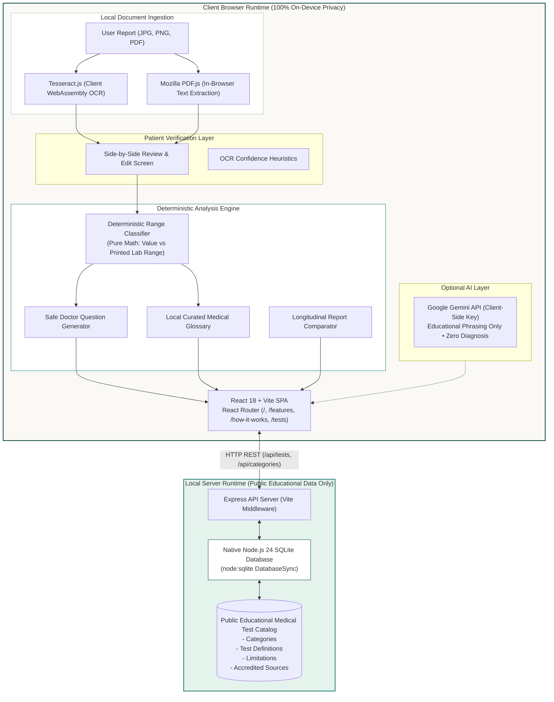

# Spark Decoded — Technical Architecture & System Design

**Project:** Spark Decoded  
**Team:** Solvyn  
**Event:** AAYU Hackathon 2026 — Problem Statement T02 (Report, Decoded)  

---

## 1. High-Level Architecture Diagram



---

## 2. Privacy & Security Boundary

Spark Decoded implements an **absolute privacy boundary**:

| Data Domain | Storage Location | Server Transmission | Retention Policy |
|---|---|---|---|
| **Patient Report Images & PDFs** | Client Memory (RAM) | **None (0 bytes)** | Cleared on page refresh or reset |
| **Extracted Lab Values** | Client React State | **None (0 bytes)** | Cleared on page refresh or reset |
| **Patient Health Records** | **None** | **None (0 bytes)** | Zero database persistence |
| **Public Medical Test Knowledge** | `server/data/spark_decoded.sqlite` | Read-only API (`/api/tests`) | Persisted SQLite database |

---

## 3. Deterministic Range Classification Engine

The core clinical classification is implemented in [`src/utils/classifier.ts`](file:///Users/pmathur/.gemini/antigravity/scratch/report-decoded-ai/src/utils/classifier.ts):

### Mathematical Rules:
1. **Two-Sided Interval (`low - high` or `low to high`):**
   - $value < low \implies \text{BELOW\_RANGE}$
   - $low \le value \le high \implies \text{WITHIN\_RANGE}$ (Boundary values are strictly classified as within range)
   - $value > high \implies \text{ABOVE\_RANGE}$
2. **One-Sided Upper Limit (`< X` or `Up to X`):**
   - $value \le X \implies \text{WITHIN\_RANGE}$
   - $value > X \implies \text{ABOVE\_RANGE}$
3. **One-Sided Lower Limit (`> X`):**
   - $value \ge X \implies \text{WITHIN\_RANGE}$
   - $value < X \implies \text{BELOW\_RANGE}$
4. **Qualitative Values (`Negative`, `Normal`, `Non-reactive`):**
   - Match against accepted clinical negatives.
5. **Guardrail Cases:**
   - Missing value or missing reference range $\implies \text{NEEDS\_VERIFICATION}$
   - Inverted interval ($low > high$) $\implies \text{NEEDS\_VERIFICATION}$

---

## 4. SQLite Database Schema (`server/db.mjs`)

```sql
-- 1. Test Categories
CREATE TABLE test_categories (
  id TEXT PRIMARY KEY,
  slug TEXT UNIQUE NOT NULL,
  name TEXT NOT NULL,
  description TEXT,
  icon TEXT,
  display_order INTEGER DEFAULT 0
);

-- 2. Educational Test Catalog
CREATE TABLE test_catalog (
  id TEXT PRIMARY KEY,
  slug TEXT UNIQUE NOT NULL,
  name TEXT NOT NULL,
  abbreviation TEXT,
  category_id TEXT NOT NULL,
  short_description TEXT NOT NULL,
  what_it_measures TEXT NOT NULL,
  why_it_is_ordered TEXT NOT NULL,
  interpretation_limitations TEXT NOT NULL,
  factors_affecting_result TEXT,
  common_questions TEXT NOT NULL, -- JSON array
  supported_by_parser BOOLEAN DEFAULT 1
);

-- 3. Accredited Medical Sources
CREATE TABLE medical_sources (
  id TEXT PRIMARY KEY,
  title TEXT NOT NULL,
  publisher TEXT NOT NULL,
  url TEXT,
  source_type TEXT
);
```

---

## 5. Technology Stack Summary

- **Frontend:** React 18, TypeScript 5.6, Vite 5.4, React Router 7, Tailwind CSS 3.4
- **Graphics & 3D:** Three.js (WebGL 3D Core with orbital rings & particles), Lucide React
- **Client-Side Document Parsing:** Tesseract.js (Wasm OCR), Mozilla PDF.js (v4)
- **Backend & Database:** Node.js 24 native `node:sqlite` (`DatabaseSync`), Express 5
- **Testing:** Vitest 2.1 (28 automated unit tests)
